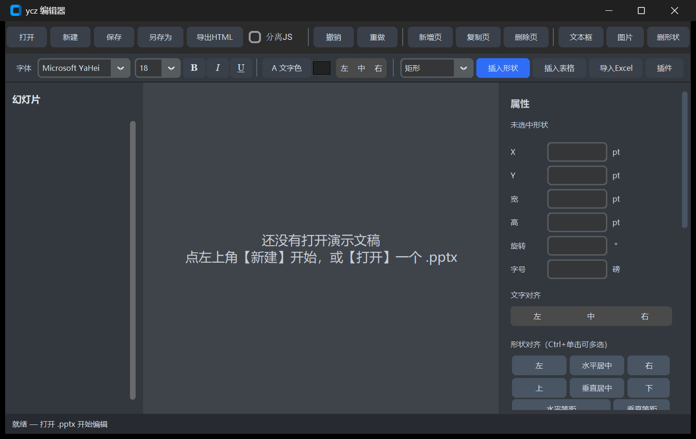

# ycz

**一个零第三方依赖的 PPTX 编辑器 —— C++ 内核 + Python 界面，插件可扩展，可导出带脚本与媒体的 HTML 放映。**

> 目标不是"再做一个 PowerPoint"，而是做一个**装得下插件、改得动内核、能带走一份能放映的 HTML** 的轻量办公工具。



## 它是什么

- **C++ 内核**（`src/`）：手写 ZIP / DEFLATE / XML DOM、PPTX 读写、GDI+ 渲染、HTML 放映导出
- **Python 界面**（`src/pyui/`）：customtkinter 三栏布局 + tkinter Canvas 画布
- **插件系统**（`plugins/`、`sdk/`）：运行时加载 `build/plugins/*.dll`，一个 dll = 一个插件
- **无第三方依赖**：C++ 侧除 Windows 自带 GDI+ 外不链任何库；ZIP 解压与 XML 解析全部手写

## 功能

| 模块 | 已实现 |
|---|---|
| 文档 | 打开/新建/保存/另存、撤销 80 步、模板新建 |
| 文字 | 字体/字号/粗斜下划线/颜色/对齐、画面内就地编辑、超长文字自动缩小 |
| 形状 | 45 个预设（基本/线条箭头/立体/流程图）、拖动、缩放、旋转、多选、对齐分布、吸附参考线 |
| 表格 | Excel 风格（细网格 + 灰表头）、整表拖动、单元格选中/输入/方向键导航、加删行列、导入/导出 Excel |
| 媒体 | 图片、音视频、网页快照、嵌入外部程序、每个形状可挂 JS 脚本（带语法高亮） |
| 动画 | 17 种切换动画 + 形状入场动画 |
| 导出 | 单文件 HTML 放映、分离 JS 版；导出 HTML 内可画笔批注、翻页、全屏 |
| 插件 | 水印 / 进度条 / 统计 / 网页嵌入，见 sdk/ |

## 构建

需要 **Windows 10/11 x64** + **MinGW-w64 (x86_64)** + PowerShell。

```powershell
# 编译器在 PATH 里（或用环境变量 YCZ_GXX 指定）
powershell -ExecutionPolicy RemoteSigned -File build.ps1
```

产物：

```
build\pptx-core.dll        内核（Python 通过 ctypes 调用）
build\plugins\*.dll        示例插件
build\pptx-tool.exe        可选命令行工具（加 -WithExe）
```

> 默认不生成 exe：部分杀软对刚链接出的未签名 exe 比较敏感。

## 运行

```powershell
pip install customtkinter pillow      # 仅这两项
python src\pyui\editor.py             # 或用打包好的便携版
```

`src\pyui\core.py::find_dll()` 会依次在 `src\pyui`、`build\`、`..\build` 等位置找 `pptx-core.dll`，所以只要保持 `src\` 与 `build\` 同级即可。

## 打包成 exe（可选）

```powershell
pip install pyinstaller
pyinstaller --noconfirm --onedir --windowed --name ycz --contents-directory "." `
  --icon ycz.ico --add-data "build\pptx-core.dll;build" `
  --add-data "build\plugins;build\plugins" --add-data "templates\空白.pptx;templates" `
  --collect-data customtkinter src\pyui\editor.py
```

冻结后资源路径走 `sys._MEIPASS`，`core.find_dll()` 与 `editor._app_root()` 已适配。

## 插件

**一个 dll 就是一个插件**，放进 `build\plugins\` 重启即生效，删掉即卸载。

最小实现两个函数：

```cpp
const PptPluginInfo* GetPluginInfo();   // 名字/作者/版本/简介
int InitPlugin(const PptHostIf* host);  // 宿主表：log / slide_count / slide_title / 画布尺寸
```

可选钩子：`HookHtmlHead`、`HookHtmlSlide`、`HookTransition`、`HookCommand`。

编译：

```bash
g++ -std=c++17 -O2 -shared -DPPT_PLUGIN_EXPORTS my_plugin.cpp -o my_plugin.dll -static-libgcc -static-libstdc++
```

ABI 只用 C 导出 + POD 结构 + char 缓冲区，不跨 dll 传 `std::string`。详见 `sdk/`（含一个可直接编译的页码插件）。

## 测试

```powershell
python test_core.py        # 内核 + ctypes：编辑、撤销、回写保真、导出
python test_editor.py      # 界面：多选、对齐、存盘往返
python test_excel_table.py # 表格 Excel 风格与导入导出
```

共 15 个测试脚本，覆盖内核、界面、表格、动画、插件、脚本高亮等。

## 已知问题

- 整页渲染约 **200 ms/帧**（GDI+ 逐形状绘制，含阴影/图片），拖动时已改为"只画选框、停手再渲染"，但尚未做渲染缓存与脏矩形
- 单文件 exe 启动需解包，约 2–4 秒
- 表格不支持合并单元格、列宽拖拽、公式
- 文字排版为手算换行 + 自动缩小（下限 55%），行距/段距控制较粗
- 未签名 exe / 新编 dll 可能被 360 等误报，加信任即可
- 仅 Windows（依赖 GDI+ 与 Win32 API）

## 关于 AI 参与

**本项目代码几乎全部由一个 AI Agent（豆包）生成。**

人类作者负责：产品定位与交互设计、需求拆解与优先级、每一轮的功能验收与回归测试、缺陷复现与修复方向决策、打包发布与维护。

如果你在意 AIGC 来源，请知悉这一点后再决定是否使用或贡献。项目以 MIT 协议开源，欢迎任何人修改、分发、商用。

Code largely written by an AI agent under human direction, review and testing.

## License

MIT
